# YAML Editor — Architecture & Detailed Design

Detailed architecture, component design, package layout, and implementation plan for the YAML Schema-Based Editor.

---

## Table of Contents

- [Package Structure](#package-structure)
- [Component Overview](#component-overview)
- [Shared Components (tom\_editors\_shared)](#shared-components-tom_editors_shared)
- [Core Components (tom\_yaml\_editor)](#core-components-tom_yaml_editor)
- [Data Flow](#data-flow)
- [Component Relationships](#component-relationships)
- [Tree Rendering Pipeline](#tree-rendering-pipeline)
- [Validation Pipeline](#validation-pipeline)
- [Subtree Inspector Design](#subtree-inspector-design)
- [Extension Mechanism](#extension-mechanism)
- [Implementation Plan](#implementation-plan)

---

## Package Structure

The editor ecosystem is split across three packages to maximize reuse:

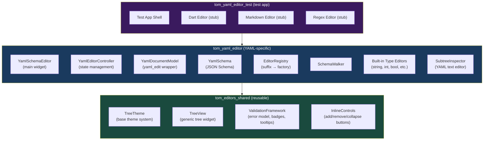

### Package Dependency Rules

| Package | Depends On | Published |
|---------|-----------|-----------|
| `tom_editors_shared` | Flutter SDK only | Yes (pub.dev) |
| `tom_yaml_editor` | `tom_editors_shared`, `yaml`, `yaml_edit` | Yes (pub.dev) |
| `tom_yaml_editor_test` | `tom_yaml_editor` (path dep) | No (app) |

---

## Component Overview

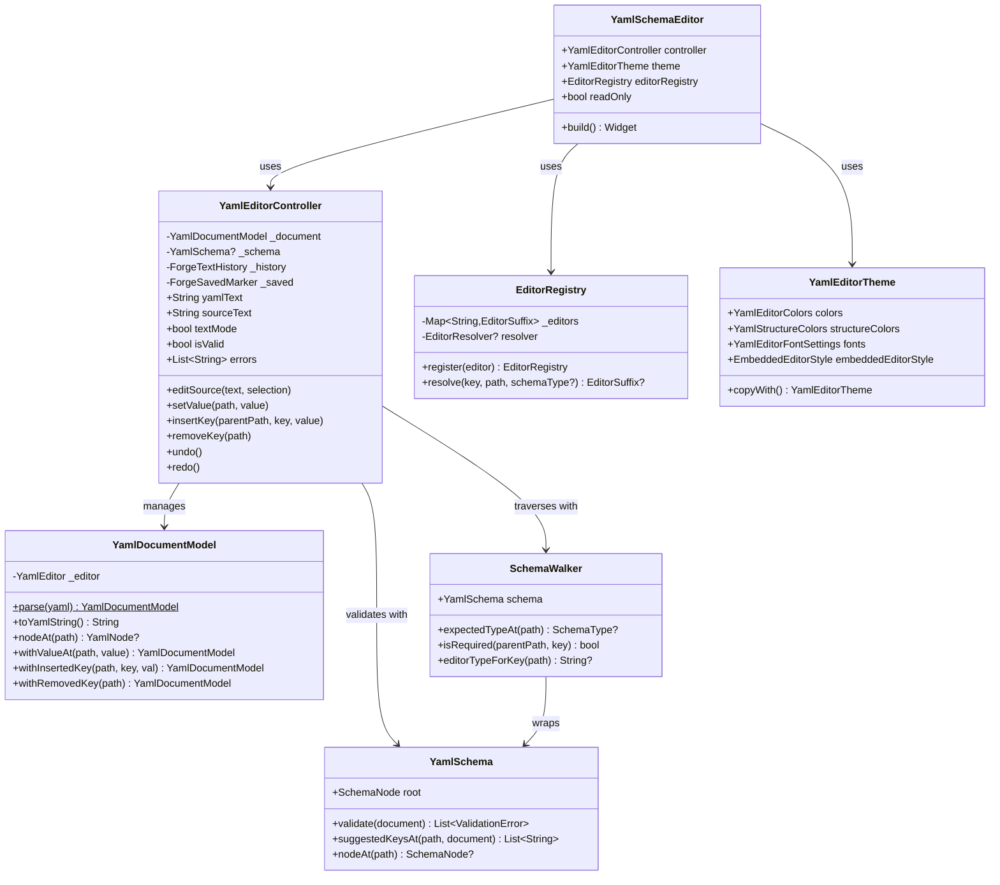

---

## Shared Components (tom_editors_shared)

These components are generic enough to be used by any tree-based editor (YAML, JSON, TOML, XML, config files). They contain **zero YAML-specific logic**.

### 1. TreeView Widget

A generic, recursive tree widget for rendering hierarchical data with expand/collapse, indent guides, and keyboard navigation.

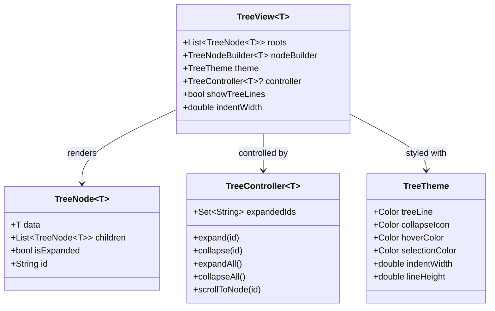

**Why shared:** Any structured editor needs a tree. JSON editors, TOML editors, file browsers — they all need expand/collapse, indent guides, keyboard nav.

### 2. ValidationFramework

Generic validation error model, badge/marker widgets, and tooltip display.

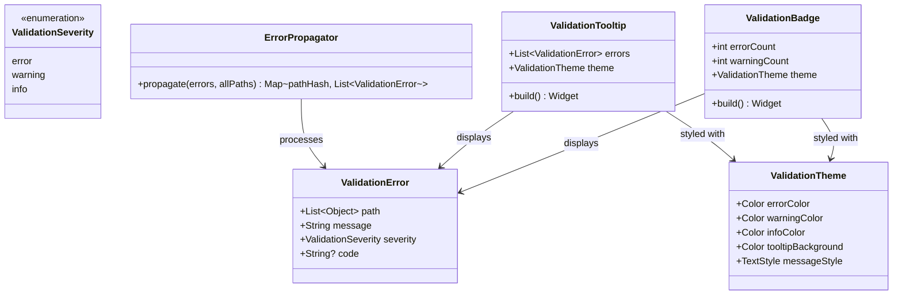

**Why shared:** Validation badges, error tooltips, and severity colors are needed by any schema-aware editor.

### 3. The undo stack

The controller keeps the Forge history contract (tom_forge_ui's
`editor_history_contract.md`) with the shared helpers of `tom_editors_shared`.
The document is its source text, and its one history is a `ForgeTextHistory`
over that text (on `tom_undo`'s `TomUndoStack`):

- a tree edit (`YamlEditOperation`) is recorded once it applied and only when
  it changed the text; edits of the same field with no pause between them
  (`setValue` on one path) are one entry, every structural edit is its own;
- typing in source mode (`editSource`) is one entry per gesture, and source
  that does not parse is a draft the history keeps like any other text — the
  tree shows the last text that parsed, and leaving source mode needs text
  that parses;
- undo and redo restore the text and the caret; the views follow;
- dirty is a `ForgeSavedMarker` on the source text, so undoing back to the
  saved text is clean;
- the mode (`textMode`) is the document's, so split views share it; a mode
  switch, a save and focus leaving a field end the typing in progress;
- `replaceContent` (reload, revision restore) makes new text the saved state
  and clears the history.

The tree's inline fields keep no history of their own (`ForgeTextField`
with `undoOwnedByHost`, `ForgeEditorOwnsUndo`), drop the echo of a value set
by undo, put the caret at the change, and number fields write no null while
typing. Host-registered embedded editors write through `setValue` into the same
history; their popout reaches it through `ForgeEditorOwnsUndo(onUndo, onRedo)`.

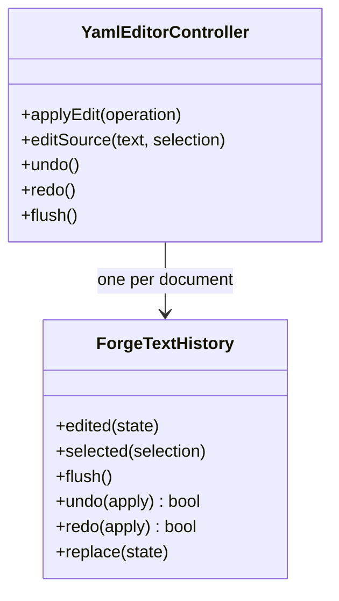

### 4. TomTextSource (tom_file_editors)

The source editor of `tom_file_editors` (`tom_ai/modules`): monospaced, line numbers, the highlighter's colours, markers drawn as wavy underlines, find, and the line edits and clipboard reached through its state. Text mode and the subtree inspector show it in the editor's theme (`yamlSourceStyle`, `yamlSourceHighlighter` in `lib/src/text_editor/yaml_source_view.dart`).

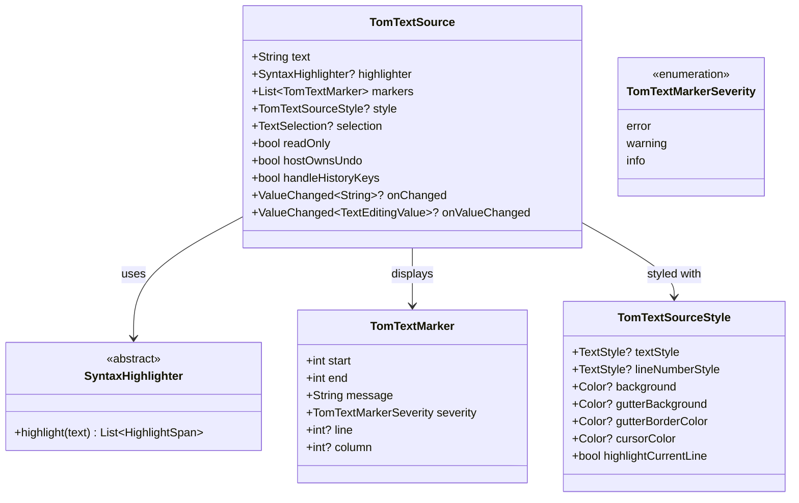

The markers are neutral: `SchemaMarkerGenerator` maps the schema findings onto them, the text mode adds the parse error. `registerYamlSourceActions` offers the source's clipboard and line edits to the editor's action integration while text mode shows it.

**Why shared:** Any editor that opens a raw-text sub-editor (JSON fragment, YAML subtree, TOML section) needs line numbers, syntax highlighting, and error markers.

### 5. InlineControls

Reusable add/remove/collapse button widgets and action row layouts.

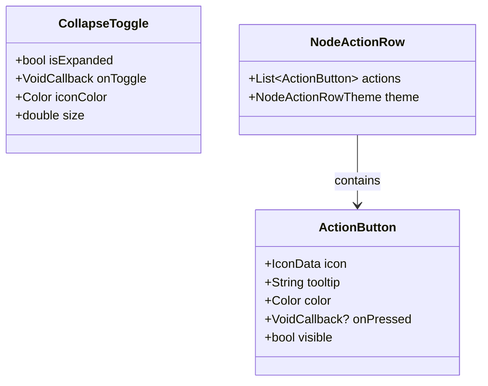

**Why shared:** Add/remove/collapse buttons with consistent styling are needed in every tree-based editor.

---

## Core Components (tom_yaml_editor)

These components are YAML-specific and depend on `tom_editors_shared`.

### Built-In Type Editors

Each basic type has a dedicated widget. All implement the same protocol:

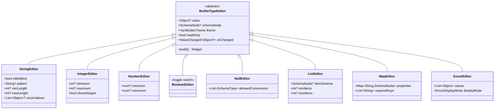

### SubtreeInspector

The subtree inspector combines `TomTextSource` (from `tom_file_editors`) with YAML-specific syntax highlighting and schema-aware markers:

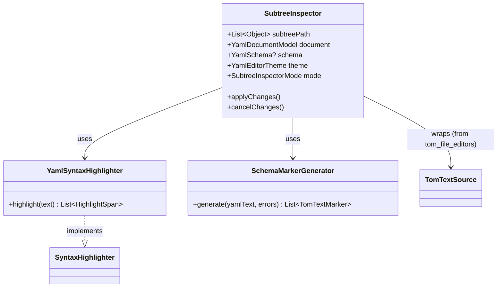

---

## Data Flow

### Edit Cycle (Tree View)

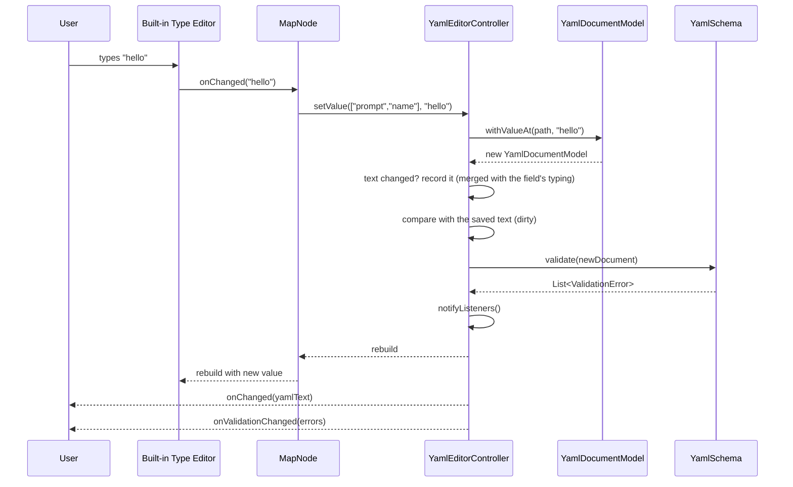

### Edit Cycle (Subtree Inspector)

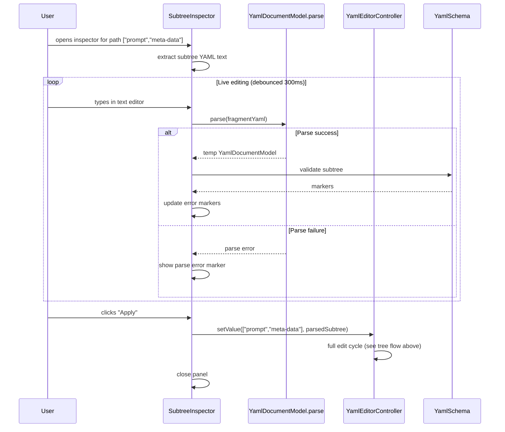

### Undo/Redo Flow

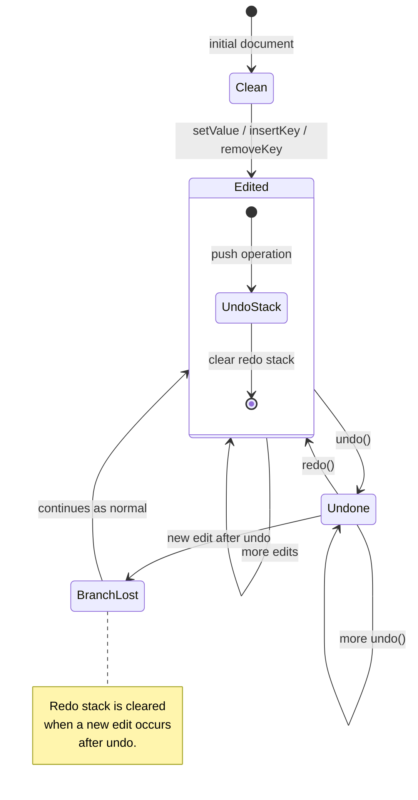

---

## Component Relationships

### Full Dependency Graph

```mermaid
graph TD
    YSE["YamlSchemaEditor"] --> YEC["YamlEditorController"]
    YSE --> ER["EditorRegistry"]
    YSE --> YET["YamlEditorTheme"]
    YSE --> TV_W["TreeView (shared)"]
    YSE --> SI["SubtreeInspector"]
    YSE --> VEL["ValidationErrorList"]

    YEC --> YDM["YamlDocumentModel"]
    YEC --> YS["YamlSchema"]
    YEC --> UH["TomUndoStack (tom_undo)"]
    YEC --> SW["SchemaWalker"]

    SI --> TEC["TomTextSource (tom_file_editors)"]
    SI --> YSH["YamlSyntaxHighlighter"]
    SI --> SMG["SchemaMarkerGenerator"]

    VEL --> VF["ValidationFramework (shared)"]

    TV_W --> TT["TreeTheme (shared)"]

    ER --> ES["EditorSuffix"]
    ER --> ERv["EditorResolver"]

    YS --> SN["SchemaNode"]
    SW --> YS

    SMG --> YS

    YSE --> BTE_S["StringEditor"]
    YSE --> BTE_I["IntegerEditor"]
    YSE --> BTE_N["NumberEditor"]
    YSE --> BTE_B["BooleanEditor"]
    YSE --> BTE_Null["NullEditor"]
    YSE --> BTE_L["ListEditor"]
    YSE --> BTE_M["MapEditor"]
    YSE --> BTE_E["EnumEditor"]

    subgraph shared["tom_editors_shared"]
        TV_W
        TT
        VF
        UH
        TEC
        IC["InlineControls"]
    end

    subgraph yaml["tom_yaml_editor"]
        YSE
        YEC
        YDM
        YS
        ER
        SW
        SI
        YSH
        SMG
        VEL
        YET
        ES
        ERv
        SN
        BTE_S
        BTE_I
        BTE_N
        BTE_B
        BTE_Null
        BTE_L
        BTE_M
        BTE_E
    end

    style shared fill:#1a4a3e,color:#fff
    style yaml fill:#1a3a5e,color:#fff
```

---

## Tree Rendering Pipeline

How the widget tree is built from a YAML document:

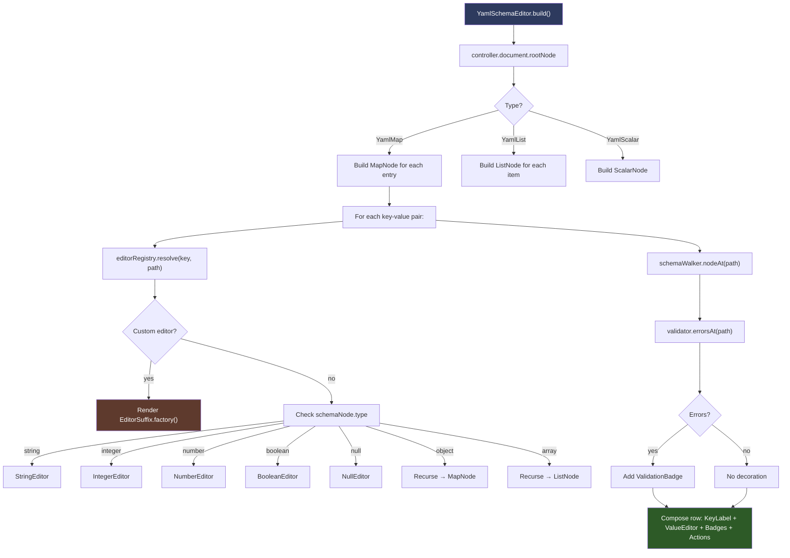

---

## Validation Pipeline

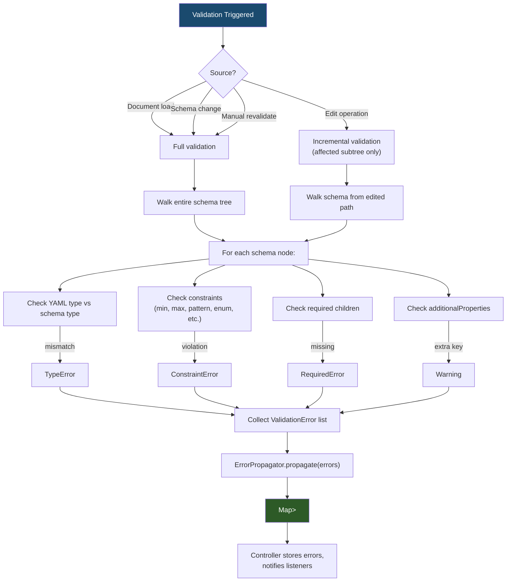

---

## Subtree Inspector Design

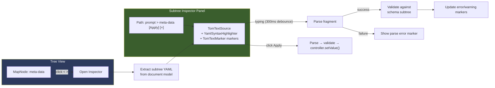

### Inspector Modes

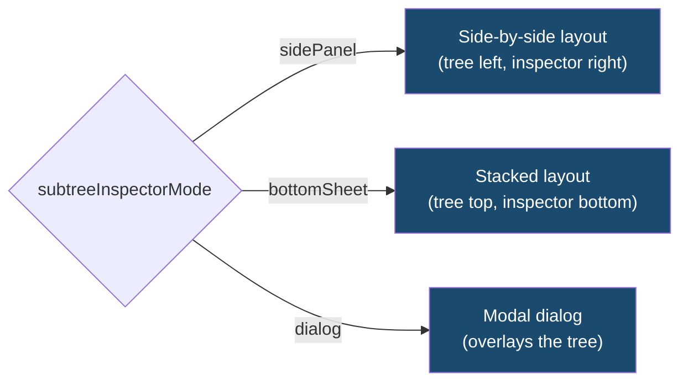

---

## Extension Mechanism

### How Custom Editors Plug In

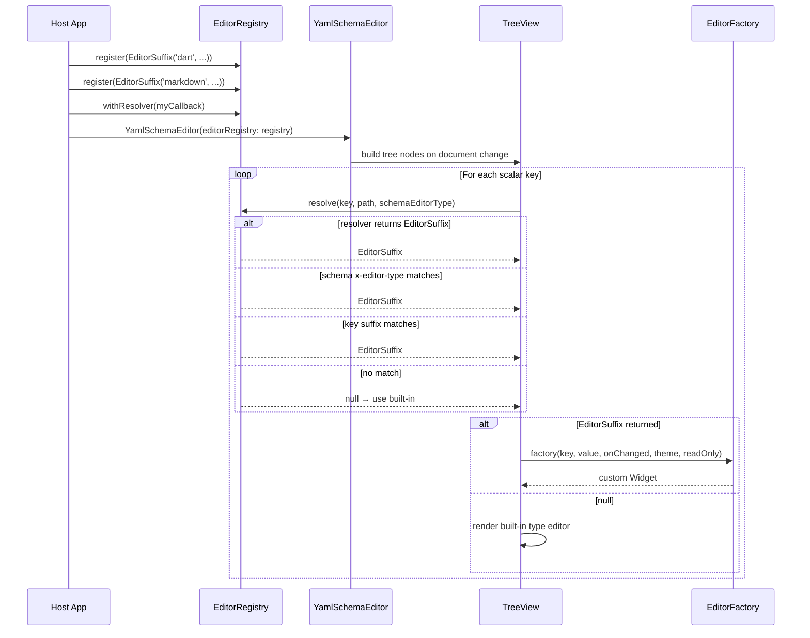

---

## Implementation Plan

### Legend

- **Phase**: logical grouping of related tasks
- **Priority**: execution order (1 = first)
- **Package**: which package the work goes into
- **Deps**: tasks that must be complete before this one can start

---

### Phase 1 — Shared Foundation (`tom_editors_shared`)

These are generic, reusable components with zero YAML knowledge.

| # | Task | Description | Package | Deps | Est | Status |
|---|------|-------------|---------|------|-----|--------|
| 1.1 | **Create `tom_editors_shared` package** | `pubspec.yaml`, `analysis_options.yaml`, barrel file, README | `tom_editors_shared` | — | S | ✅ Done |
| 1.2 | **`UndoHistory<T>`** | Generic typed undo/redo stack with `push`, `undo`, `redo`, `clear`, `canUndo`/`canRedo`, configurable `maxDepth`. Unit tests. | `tom_editors_shared` | 1.1 | S | ✅ Done |
| 1.3 | **`ValidationError` model** | `ValidationError` (path, message, severity, code), `ValidationSeverity` enum, `ErrorPropagator` (propagate errors up path ancestors). Unit tests. | `tom_editors_shared` | 1.1 | S | ✅ Done |
| 1.4 | **`ValidationBadge` widget** | Small colored badge showing error/warning count. Themed via `ValidationTheme`. Widget tests. | `tom_editors_shared` | 1.3 | S | ✅ Done |
| 1.5 | **`ValidationTooltip` widget** | Mouse-over tooltip listing errors with severity icons, path, and message. Themed. Widget tests. | `tom_editors_shared` | 1.3 | S | ✅ Done |
| 1.6 | **`TreeNode<T>` model + `TreeController<T>`** | Generic tree node model with children, expanded state, id. Controller with `expand`/`collapse`/`expandAll`/`scrollToNode`. Unit tests. | `tom_editors_shared` | 1.1 | M | ✅ Done |
| 1.7 | **`TreeView<T>` widget** | Renders `List<TreeNode<T>>` with indent guides, tree lines, collapse toggles, keyboard navigation (up/down/left/right/enter). Accepts a `nodeBuilder` for custom row rendering. `TreeTheme` styling. Widget tests. | `tom_editors_shared` | 1.6 | L | ✅ Done |
| 1.8 | **`InlineControls`** | `CollapseToggle`, `ActionButton`, `NodeActionRow` — small reusable button widgets. Widget tests. | `tom_editors_shared` | 1.1 | S | ✅ Done |
| 1.9 | **`SyntaxHighlighter` abstract + `TextMarker`** | Abstract `SyntaxHighlighter` interface, `TextMarker` model (line, col range, type, tooltip), `TextMarkerType` enum. | `tom_editors_shared` | 1.1 | S | ✅ Done |
| 1.10 | **`TextEditorCore` widget** | Themed text editor with line numbers, gutter, syntax highlighting integration, marker overlay (squiggly underlines), marker gutter icons, tooltip on hover. Widget tests. | `tom_editors_shared` | 1.9 | L | ✅ Done |

**Phase 1 deliverable:** A publishable `tom_editors_shared` package with generic tree, validation, undo, text editor, and control widgets. Zero YAML dependency.

---

### Phase 2 — YAML Document Layer (`tom_yaml_editor`)

These tasks build the non-visual YAML document model and schema validation.

| # | Task | Description | Package | Deps | Est | Status |
|---|------|-------------|---------|------|-----|--------|
| 2.1 | **Migrate `YamlEditorController` to `UndoHistory`** | Replace inline undo/redo stacks with `UndoHistory<YamlEditOperation>` from shared. Controller delegates to the shared stack. Unit tests. | `tom_yaml_editor` | 1.2 | S | ✅ Done |
| 2.2 | **Implement `YamlSchema.validate()`** | Walk the schema tree against the document, producing `List<ValidationError>`. Check type, required, pattern, min/max, enum, additionalProperties. Unit tests with known-good and known-bad YAML documents. | `tom_yaml_editor` | 1.3 | L | ✅ Done |
| 2.3 | **`SchemaMarkerGenerator`** | Given parsed YAML text and a schema + base path, produce `List<TextMarker>` mapping validation errors to line/column positions. Unit tests. | `tom_yaml_editor` | 2.2, 1.9 | M | ✅ Done |
| 2.4 | **`YamlSyntaxHighlighter`** | Implement `SyntaxHighlighter` from shared for YAML: keys, values, comments, block scalars, anchors/aliases, flow collections, tag tokens. All colored per `YamlEditorTheme`. Unit tests. | `tom_yaml_editor` | 1.9 | M | ✅ Done |
| 2.5 | **Add `revalidate()` to controller** | Force full re-validation, store errors as `List<ValidationError>`, expose `validationErrorsAt(path)`. Unit tests. | `tom_yaml_editor` | 2.2 | S | ✅ Done |
| 2.6 | **Add `subtreeYamlAt(path)` to `YamlDocumentModel`** | Extract the raw YAML text for a subtree (preserving comments). Also add `replaceSubtreeAt(path, yamlFragment)` to splice edited text back. Unit tests. | `tom_yaml_editor` | — | M | ✅ Done |

**Phase 2 deliverable:** Complete non-visual YAML layer with validation, syntax highlighting, subtree extraction, and undo powered by shared infrastructure.

---

### Phase 3 — Built-In Type Editors (`tom_yaml_editor`)

Individual scalar editor widgets, each self-contained.

| # | Task | Description | Package | Deps | Est | Status |
|---|------|-------------|---------|------|-----|--------|
| 3.1 | **`StringEditor` widget** | TextField, multi-line support, placeholder, pattern validation indicator, themed. Widget tests. | `tom_yaml_editor` | — | M | ✅ Done |
| 3.2 | **`IntegerEditor` widget** | Numeric TextField, input filter, optional ± stepper, min/max validation. Widget tests. | `tom_yaml_editor` | — | S | ✅ Done |
| 3.3 | **`NumberEditor` widget** | Like IntegerEditor but accepts decimals. Widget tests. | `tom_yaml_editor` | 3.2 | S | ✅ Done |
| 3.4 | **`BooleanEditor` widget** | Toggle switch, true/false labels, keyboard support. Widget tests. | `tom_yaml_editor` | — | S | ✅ Done |
| 3.5 | **`NullEditor` widget** | Null chip, type conversion popup. Widget tests. | `tom_yaml_editor` | — | S | ✅ Done |
| 3.6 | **`EnumEditor` widget** | Segmented buttons (≤4), dropdown (5–8), searchable dropdown (>8). Widget tests. | `tom_yaml_editor` | — | M | ✅ Done |
| 3.7 | **`BuiltInEditorFactory`** | Factory function that maps `SchemaType` + `SchemaNode` to the correct built-in widget. Falls back to `StringEditor` for unknowns. Unit tests. | `tom_yaml_editor` | 3.1–3.6 | S | ✅ Done |

**Phase 3 deliverable:** All scalar editors render standalone. Each can be tested in isolation before integration.

---

### Phase 4 — Tree Rendering (`tom_yaml_editor`)

Wire the tree view, built-in editors, and validation together.

| # | Task | Description | Package | Deps | Est | Status |
|---|------|-------------|---------|------|-----|--------|
| 4.1 | **YAML-specific `TreeNode` builder** | Walk `YamlDocumentModel` + `SchemaWalker` to produce `TreeNode<YamlTreeData>` list. Each node carries: path, key, YamlNode, SchemaNode?, validation errors. Unit tests. | `tom_yaml_editor` | 1.6, 2.2 | M | ✅ Done |
| 4.2 | **`MapNode` row widget** | Renders one map entry: `KeyLabel` (with required badge) + `ValueEditor` (from `BuiltInEditorFactory` or `EditorRegistry`) + `NodeActions` (add, remove, inspect). Widget tests. | `tom_yaml_editor` | 3.7, 1.8 | L | ✅ Done |
| 4.3 | **`ListNode` row widget** | Renders one list item: drag handle + index + `ValueEditor` + `NodeActions`. Drag-to-reorder via `ReorderableListView`. Widget tests. | `tom_yaml_editor` | 3.7, 1.8 | M | ✅ Done |
| 4.4 | **`KeyLabel` widget** | Styled key text + required badge + error badge + colon separator. Inline editing on double-click. Widget tests. | `tom_yaml_editor` | 1.4 | S | ✅ Done |
| 4.5 | **`NodeActions` widget** | Row of action buttons: add (from schema suggestions), remove, inspect subtree. Visibility controlled by theme toggles and `readOnly`. Widget tests. | `tom_yaml_editor` | 1.8 | S | ✅ Done |
| 4.6 | **`YamlSchemaEditor.build()` implementation** | Wire everything: create YAML tree nodes from document, pass to `TreeView`, each node renders `MapNode` or `ListNode` or `ScalarNode`. Validation badges + tooltips on flagged nodes. Error propagation to ancestors. | `tom_yaml_editor` | 4.1–4.5, 1.7 | L | ✅ Done |
| 4.7 | **Collapse/expand persistence** | Remember expanded state across document edits (by path hash). When a new key is inserted, auto-expand its parent. | `tom_yaml_editor` | 4.6 | S | ✅ Done |
| 4.8 | **Keyboard navigation** | Arrow keys navigate between nodes, Enter/Space activates editor, Escape closes editor, Tab moves to next sibling. | `tom_yaml_editor` | 4.6 | M | ✅ Done |

**Phase 4 deliverable:** The `YamlSchemaEditor` renders a fully interactive YAML tree with built-in type editors, validation indicators, and keyboard navigation.

---

### Phase 5 — Subtree Inspector (`tom_yaml_editor`)

| # | Task | Description | Package | Deps | Est |
|---|------|-------------|---------|------|-----|
| 5.1 | **`SubtreeInspector` widget** | Wraps `TextEditorCore` with YAML syntax highlighting and schema markers. Header with path breadcrumb, Apply/Cancel buttons. Widget tests. | `tom_yaml_editor` | 1.10, 2.3, 2.4, 2.6 | L | ✅ Done |
| 5.2 | **Side panel mode** | `SubtreeInspectorMode.sidePanel`: tree and inspector side by side with resizable divider. Widget tests. | `tom_yaml_editor` | 5.1 | M | ✅ Done |
| 5.3 | **Bottom sheet mode** | `SubtreeInspectorMode.bottomSheet`: tree on top, inspector on bottom with resizable divider. Widget tests. | `tom_yaml_editor` | 5.1 | S | ✅ Done |
| 5.4 | **Dialog mode** | `SubtreeInspectorMode.dialog`: modal dialog overlay. Widget tests. | `tom_yaml_editor` | 5.1 | S | ✅ Done |
| 5.5 | **Live preview** | Debounced parsing + validation as user types. Tree view highlights the edited subtree. | `tom_yaml_editor` | 5.1, 4.6 | M | ✅ Done |
| 5.6 | **Apply/Cancel flow** | Apply: parse fragment, validate, if valid → `controller.setValue()`, close inspector. Cancel: discard, close. If parse errors → block Apply with alert. | `tom_yaml_editor` | 5.1, 2.6 | S | ✅ Done |

**Phase 5 deliverable:** Full subtree inspection with three layout modes, live preview, and schema markers in the text editor.

---

### Phase 6 — Validation Error List (`tom_yaml_editor`)

| # | Task | Description | Package | Deps | Est |
|---|------|-------------|---------|------|-----|
| 6.1 | **`ValidationErrorList` widget** | Scrollable list of all validation errors with severity icon, path breadcrumb, and message. Click-to-navigate. Themed. Widget tests. | `tom_yaml_editor` | 1.3, 1.4 | M | ✅ Done |
| 6.2 | **Error list positioning** | `ErrorListPosition.bottom` and `.side` layouts integrated into `YamlSchemaEditor`. Widget tests. | `tom_yaml_editor` | 6.1, 4.6 | S | ✅ Done |
| 6.3 | **Error row highlighting** | `highlightErrorRows: true` tints tree row backgrounds for nodes with errors. Widget tests. | `tom_yaml_editor` | 4.6 | S | ✅ Done |

**Phase 6 deliverable:** Optional error summary panel with click-to-navigate and sortable errors.

---

### Phase 7 — Test Custom Editors (`tom_yaml_editor_test`)

Verify the extension mechanism works end-to-end with real custom editors.

| # | Task | Description | Package | Deps | Est | Status |
|---|------|-------------|---------|------|-----|--------|
| 7.1 | **Upgrade `DartEditorStub`** | Replace the current `TextField` stub with a proper colored text area with Dart keyword highlighting (basic regex-based). Register as `EditorSuffix(suffix: 'dart')`. | `tom_yaml_editor_test` | 4.6 | M | ✅ Done |
| 7.2 | **Upgrade `MarkdownEditorStub`** | Add a preview/edit toggle: edit mode = text area, preview mode = rendered markdown (using a simple parser). Register as `EditorSuffix(suffix: 'markdown')`. | `tom_yaml_editor_test` | 4.6 | M | ✅ Done |
| 7.3 | **Upgrade `RegexEditorStub`** | Add a test input field and live match indicator (green/red border). Register as `EditorSuffix(suffix: 'regex')`. | `tom_yaml_editor_test` | 4.6 | S | ✅ Done |
| 7.4 | **Add `JsonEditorStub`** | TextArea with JSON formatting on paste and basic brace matching. Register as `EditorSuffix(suffix: 'json')`. | `tom_yaml_editor_test` | 4.6 | S | ✅ Done |
| 7.5 | **Add `ColorPickerStub`** | Hex input + color swatch preview. Register as `EditorSuffix(suffix: 'color')`. Register via the `EditorResolver` callback to also match any key containing "color" regardless of suffix. | `tom_yaml_editor_test` | 4.6 | S | ✅ Done |
| 7.6 | **End-to-end test scenario** | Load `sample_prompt.yaml` with `prompt_schema.json`, verify: tree renders, built-in editors work, custom editors activate for suffix keys, validation badges appear, subtree inspector opens, apply/cancel works, undo/redo works. Manual test + screenshot. | `tom_yaml_editor_test` | 7.1–7.5, 5.6 | L | ✅ Done |
| 7.7 | **Control panel integration** | Update the test app control panel: theme toggle (dark/light), all feature switches, error list toggle, inspector mode selector, registry stats display. | `tom_yaml_editor_test` | 7.6 | M | ✅ Done |

**Phase 7 deliverable:** Test app demonstrates all features with 5 custom editors, full theming, and all feature toggles.

---

### Phase 8 — Polish & Documentation

| # | Task | Description | Package | Deps | Est | Status |
|---|------|-------------|---------|------|-----|--------|
| 8.1 | **API documentation** | Dartdoc on all public APIs: `tom_editors_shared` and `tom_yaml_editor`. Every public class, method, and property has a doc comment with example. | both | 7.6 | M | ✅ Done |
| 8.2 | **README.md for `tom_editors_shared`** | Description, quick start, component summary, API links. | `tom_editors_shared` | 8.1 | S | ✅ Done |
| 8.3 | **README.md for `tom_yaml_editor`** | Description, screenshots, quick start, link to spec doc, API links. | `tom_yaml_editor` | 8.1 | S | ✅ Done |
| 8.4 | **Performance profiling** | Test with a 500+ key YAML document. Identify and fix any frame drops during scrolling, editing, or validation. Add lazy rendering for large documents. | `tom_yaml_editor` | 7.6 | M | ✅ Done |
| 8.5 | **Accessibility audit** | Verify keyboard navigation, screen reader labels, focus order, contrast ratios. Fix any issues. | `tom_yaml_editor` | 7.6 | M | ✅ Done |

---

### Implementation Order Summary

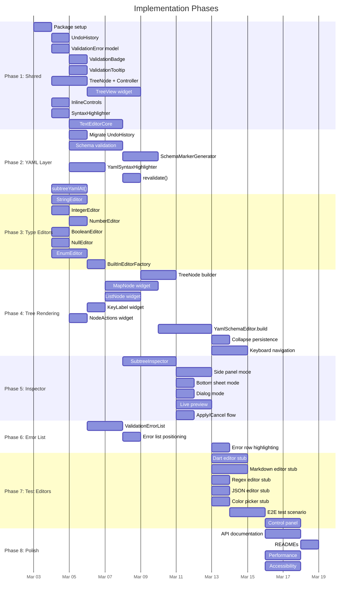

### Size Estimates

| Symbol | Meaning |
|--------|---------|
| **S** | Small — ≤ 1 hour |
| **M** | Medium — 2–4 hours |
| **L** | Large — 4–8 hours |

### Total Estimates by Phase

| Phase | Tasks | Estimated Time |
|-------|-------|---------------|
| Phase 1 — Shared Foundation | 10 | ~20 hours |
| Phase 2 — YAML Document Layer | 6 | ~12 hours |
| Phase 3 — Built-In Type Editors | 7 | ~8 hours |
| Phase 4 — Tree Rendering | 8 | ~18 hours |
| Phase 5 — Subtree Inspector | 6 | ~12 hours |
| Phase 6 — Validation Error List | 3 | ~4 hours |
| Phase 7 — Test Custom Editors | 7 | ~12 hours |
| Phase 8 — Polish & Docs | 5 | ~10 hours |
| **Total** | **52 tasks** | **~96 hours** |
