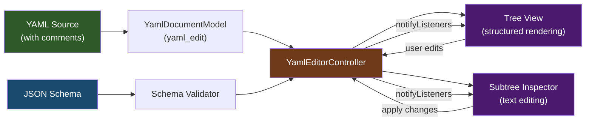
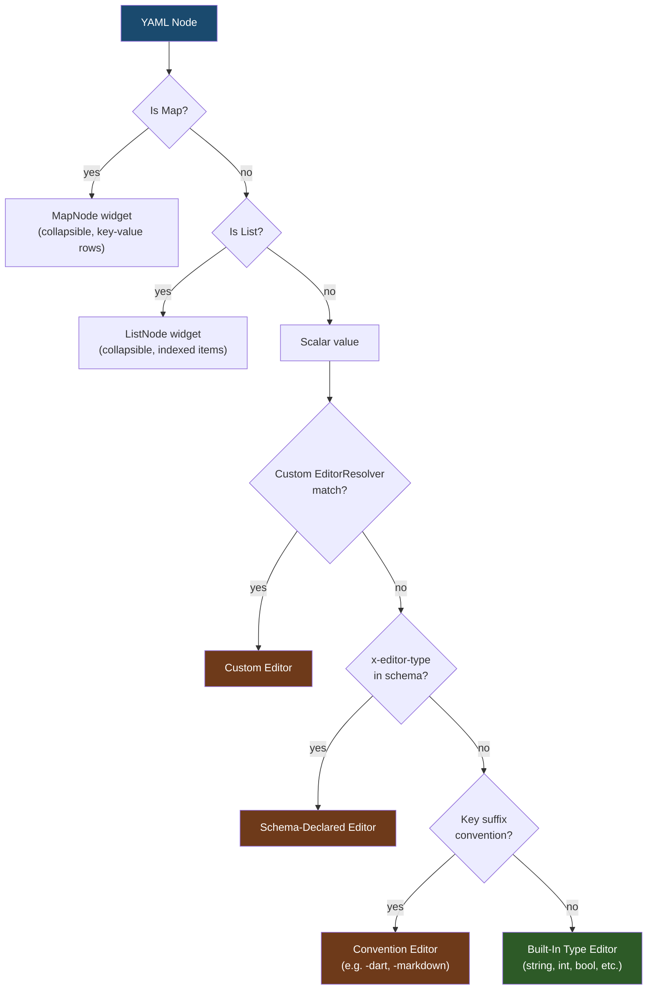
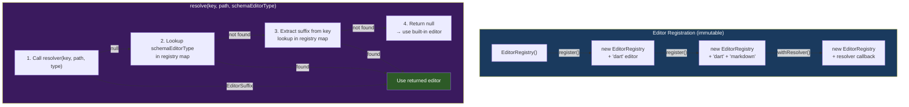
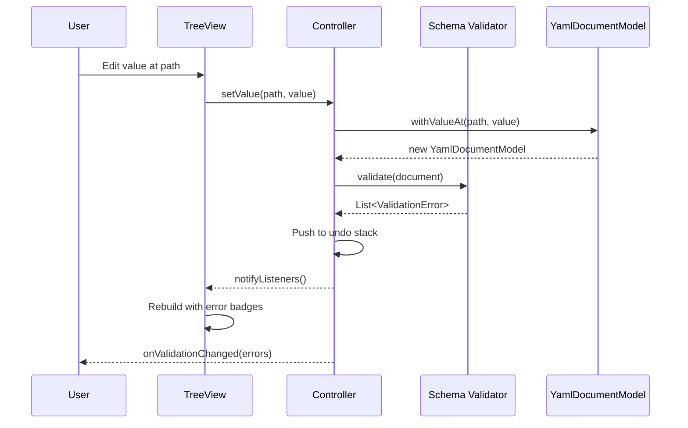
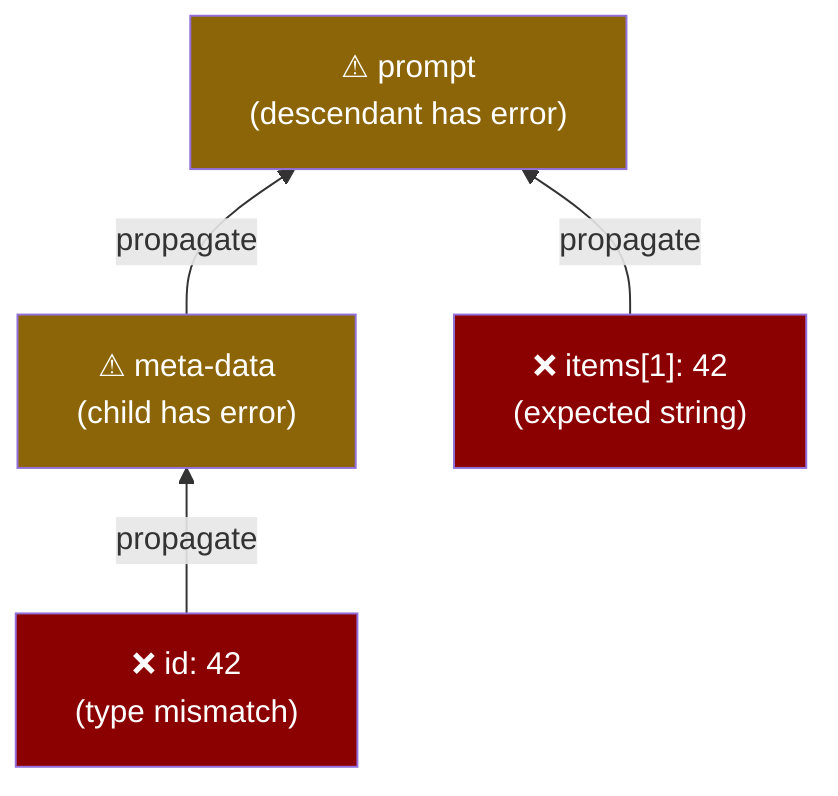
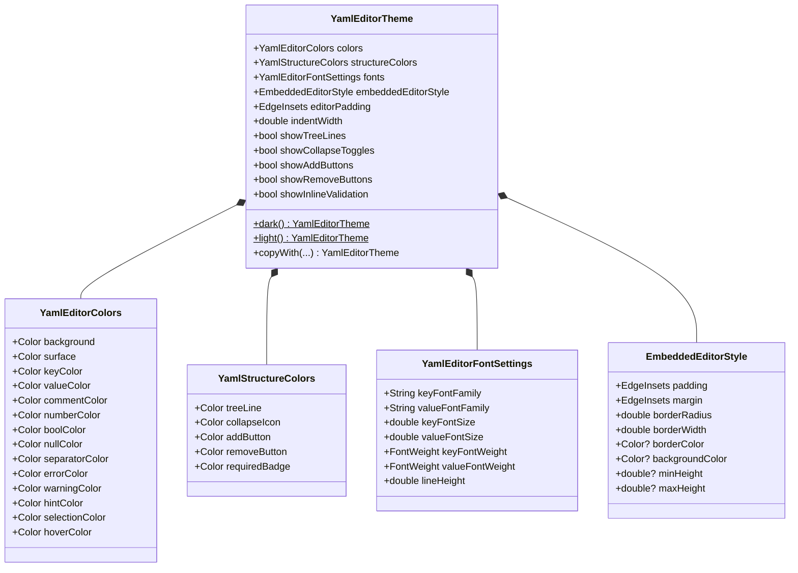
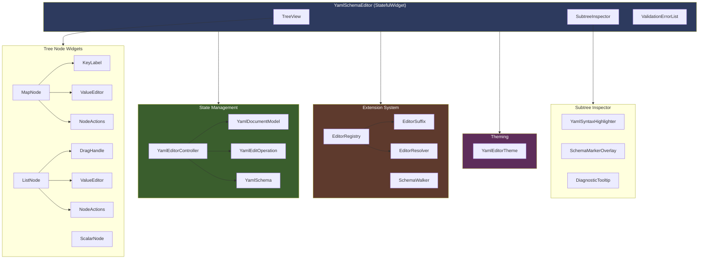

# YAML Schema-Based Editor

A non-destructive, schema-aware YAML editor widget for Flutter. Renders YAML documents as structured tree views with full JSON Schema validation, construction assistance, convention-based embedded editors, subtree inspection, and deep theming.

---

## Table of Contents

- [Core Idea](#core-idea)
- [Built-In Type Editors](#built-in-type-editors)
- [Convention-Based Editors](#convention-based-editors)
- [Subtree YAML Inspection](#subtree-yaml-inspection)
- [Schema Validation and Error Display](#schema-validation-and-error-display)
- [Embedding API](#embedding-api)
- [Controller API](#controller-api)
- [Schema Definition](#schema-definition)
- [Theming System](#theming-system)
- [Feature Toggles and Switches](#feature-toggles-and-switches)
- [Architecture](#architecture)
- [Immutability Model](#immutability-model)

---

## Core Idea

The YAML Schema-Based Editor renders a YAML document as a **structured tree view** — not a plain-text editor. Every YAML node (map, list, scalar) is displayed as a dedicated, interactive widget. The editor:

1. **Preserves everything** — comments, formatting, key order, blank lines, trailing whitespace — by operating on a non-destructive document model backed by the Dart team's `yaml_edit` package, rather than re-serializing the YAML.
2. **Validates live** against a JSON Schema, flagging violations directly on tree nodes and providing construction help (suggested keys, type constraints, required field badges).
3. **Embeds specialized editors** for scalar values based on key naming conventions (e.g., `script-dart` renders a Dart code editor inline) or explicit schema annotation (`x-editor-type`).
4. **Provides subtree inspection** — any map or list node can be opened in a YAML-optimized text editor for raw fragment editing, with schema error markers overlaid on the text.
5. **Is fully themeable** — every color, font, spacing, icon, border, and structural element can be customized, with dark and light presets as starting points.

### High-Level Data Flow



### Node Rendering Decision



---

## Built-In Type Editors

The core editor ships with built-in interactive widgets for **every basic YAML/JSON Schema type**. These are used automatically when no convention-based or custom editor is matched. Each built-in editor respects the active theme and the `readOnly` flag.

### String Editor

| Property | Behavior |
|----------|----------|
| **Widget** | Single-line `TextField` (expands to multi-line if value contains `\n` or schema sets `x-multiline: true`) |
| **Color** | `YamlEditorColors.valueColor` |
| **Validation** | `pattern` (regex), `minLength`, `maxLength`, `enum` (dropdown if ≤ 8 values) |
| **Placeholder** | Schema `description` or `"(empty string)"` for null |
| **Quotes** | Displays the YAML quote style used in the source (plain, single, double, literal block, folded block); editing preserves the original style |
| **Theme** | Font from `fonts.valueFontFamily`, size from `fonts.valueFontSize` |

### Integer Editor

| Property | Behavior |
|----------|----------|
| **Widget** | Numeric `TextField` with input filter (`FilteringTextInputFormatter.allow(RegExp(r'^-?\d*$'))`) |
| **Stepper** | Optional ± spinner buttons (shown when `minimum` and/or `maximum` are set in the schema) |
| **Color** | `YamlEditorColors.numberColor` |
| **Validation** | `minimum`, `maximum`, `multipleOf` |
| **Default** | Schema `default` value shown as placeholder |

### Number (Double) Editor

| Property | Behavior |
|----------|----------|
| **Widget** | Numeric TextField accepting decimals (`FilteringTextInputFormatter.allow(RegExp(r'^-?\d*\.?\d*$'))`) |
| **Stepper** | Optional ± spinner buttons |
| **Color** | `YamlEditorColors.numberColor` |
| **Validation** | `minimum`, `maximum`, `exclusiveMinimum`, `exclusiveMaximum` |

### Boolean Editor

| Property | Behavior |
|----------|----------|
| **Widget** | Inline toggle switch (not a checkbox) — compact, keyboard-accessible |
| **Labels** | Shows `true` / `false` text next to the toggle, colored with `YamlEditorColors.boolColor` |
| **Keyboard** | Space or Enter to toggle |
| **Theme** | Toggle track and thumb colors derived from `structureColors` |

### Null Editor

| Property | Behavior |
|----------|----------|
| **Widget** | Read-only chip displaying `null` in `YamlEditorColors.nullColor` |
| **Interaction** | Clicking (when not `readOnly`) opens a type conversion menu: convert to string, integer, boolean, list, or map |
| **Schema** | If schema allows multiple types (e.g., `["string", "null"]`), the type menu only shows allowed types |

### List (Array) Editor

| Property | Behavior |
|----------|----------|
| **Widget** | Vertical list of child nodes, each indented one level |
| **Ordering** | Drag handles for reordering items (unless `readOnly`) |
| **Add** | "+" button at the bottom creates a new item with the schema's `items` default value |
| **Remove** | "×" icon on each item (unless `readOnly` or `minItems` constraint reached) |
| **Collapse** | Collapse/expand toggle in the header showing item count: `mylist (3 items)` |
| **Validation** | `minItems`, `maxItems`, `uniqueItems` |
| **Empty state** | Displays `"(empty list)"` hint text when array has zero items |

### Map (Object) Editor

| Property | Behavior |
|----------|----------|
| **Widget** | Vertical list of key-value pairs, each indented one level |
| **Key display** | Key rendered with `YamlEditorColors.keyColor`, `fonts.keyFontFamily`, `fonts.keyFontWeight` |
| **Required badge** | Required keys show a small badge (color: `structureColors.requiredBadge`) |
| **Add** | "+" button shows a dropdown of schema-suggested keys not yet present |
| **Remove** | "×" icon on optional (non-required) keys |
| **Collapse** | Collapse/expand toggle in the header showing key count: `meta-data (4 keys)` |
| **Separator** | Colon separator colored with `YamlEditorColors.separatorColor` |
| **Key editing** | Keys are editable inline (double-click to enter edit mode) unless `readOnly` |

### Enum Editor

When a schema node specifies `enum` values:

| Values Count | Widget |
|-------------|--------|
| ≤ 4 values | Segmented button / radio group |
| 5–8 values | Dropdown menu |
| > 8 values | Searchable dropdown with type-ahead |

---

## Convention-Based Editors

Keys ending with a type suffix automatically trigger specialized inline editors. The suffix is extracted from the key: `key-<suffix>: value`.

### Built-In Suffix Convention Table

| Suffix | Editor Type | Example Key | Notes |
|--------|-------------|-------------|-------|
| `-dart` | Dart code editor | `script-dart` | Syntax highlighting, basic completion |
| `-markdown` | Markdown editor | `description-markdown` | Preview toggle |
| `-regex` | Regex editor | `filter-regex` | Live match testing |
| `-json` | JSON editor | `payload-json` | Pretty-print, validation |
| `-yaml` | YAML sub-editor | `config-yaml` | Recursive schema editor |
| `-sql` | SQL editor | `query-sql` | Keyword highlighting |
| `-uri` | URI editor | `endpoint-uri` | URL validation, scheme hints |
| `-path` | File path editor | `output-path` | Path separator handling |
| `-color` | Color picker | `accent-color` | Hex/RGB input + swatch |
| `-date` | Date picker | `created-date` | ISO 8601 formatting |
| `-cron` | Cron expression editor | `schedule-cron` | Field breakdown view |

### Schema Override

The schema's `x-editor-type` field overrides suffix-based detection:

```json
{
  "description-field": {
    "type": "string",
    "x-editor-type": "markdown"
  }
}
```

Here, `description-field` does not end with `-markdown`, but the schema annotation forces the Markdown editor.

### Registering Custom Editors

Custom editors are registered via `EditorRegistry`. The registry is **immutable** — `register()` returns a new instance:

```dart
var registry = EditorRegistry();
registry = registry.register(EditorSuffix(
  suffix: 'dart',
  label: 'Dart Code',
  icon: Icons.code,
  factory: ({key, value, onChanged, theme, readOnly}) {
    return MyDartCodeEditor(
      code: value as String? ?? '',
      onChanged: readOnly ? null : (code) => onChanged(code),
    );
  },
));
```

### Editor Resolution Priority

When rendering a scalar value, the editor is chosen by a 3-tier resolution:

| Priority | Source | Description |
|----------|--------|-------------|
| 1 (highest) | **Custom `EditorResolver` callback** | Full programmatic override — inspect key, path, schema type |
| 2 | **`x-editor-type`** in JSON Schema | Schema-declared editor type, looked up in the registry |
| 3 | **Key suffix convention** | `key-<suffix>` pattern extracted and looked up in the registry |
| 4 (fallback) | **Built-in type editor** | Schema type maps to the default built-in widget (string → TextField, boolean → toggle, etc.) |

```dart
// Custom resolver example
registry = registry.withResolver((key, path, schemaEditorType) {
  if (path.length > 2 && key.startsWith('secret-')) {
    return myPasswordEditor;
  }
  return null; // fall through to lower tiers
});
```

### Editor Registration and Lookup



---

## Subtree YAML Inspection

Any map or list node in the tree can be opened in a **YAML-optimized text editor** for raw fragment editing. This enables expert users to edit complex structures directly as text, while still benefiting from schema awareness.

### Opening the Inspector

- **Context menu** → "Edit as YAML" on any map or list node
- **Keyboard shortcut** → Ctrl+E (Cmd+E on macOS) on a focused node
- **Toolbar button** → `< >` icon in the node header (visible when `showSubtreeInspector` is enabled)

### Inspector Panel Layout

The inspector opens as a **side panel** or **bottom sheet** (configurable via `subtreeInspectorMode`):

```
┌─────────────────────────────────────────────────────┐
│  ▾ Editing: prompt > meta-data          [Apply] [✕] │
├─────────────────────────────────────────────────────┤
│  1 │ name: My Prompt                                │
│  2 │ id: my-prompt-01                               │
│  3 │ version: 2                                     │
│  4 │ tags:                     ⚠ ← schema marker   │
│  5 │   - alpha                                      │
│  6 │   - 42          ← ❌ error: expected string    │
│  7 │ # Author comment                               │
│  8 │ author: jdoe                                   │
└─────────────────────────────────────────────────────┘
```

### Text Editor Features

| Feature | Description |
|---------|-------------|
| **Syntax highlighting** | YAML-aware: keys, values, comments, block scalars, anchors, tags — all colored per theme |
| **Line numbers** | Gutter with line numbers, colored using `YamlEditorColors.hintColor` |
| **Schema error markers** | Red squiggly underlines on lines with schema violations (type mismatch, missing required key, constraint failure) |
| **Warning markers** | Orange squiggly underlines on lines with schema warnings (deprecated keys, non-standard values) |
| **Error gutter icons** | Red circle (●) or warning triangle (▲) icons in the gutter next to problematic lines |
| **Mouse-over tooltips** | Hovering over a marker shows the violation detail: `"Expected type 'string', got 'integer'"` |
| **Inline diagnostics** | Optionally show error text inline after the offending line (configurable via `showInlineDiagnostics`) |
| **Auto-indent** | YAML-aware indentation: pressing Enter preserves nesting level; Tab/Shift-Tab adjust indent |
| **Bracket matching** | Highlights matching flow-style brackets `[]` `{}` |
| **Comment toggle** | Ctrl+/ (Cmd+/) toggles `#` comment on the current line or selection |
| **Undo/redo** | Independent undo stack within the text editor (separate from the tree editor's undo history) |
| **Live preview** | As you type, the tree view updates in real-time (debounced at 300ms); parse errors are shown as markers |
| **Apply/Cancel** | "Apply" writes changes back to the document model; "Cancel" discards. Parse errors block Apply with an alert. |

### Schema Marker Types

| Marker | Icon | Color | Trigger |
|--------|------|-------|---------|
| **Error** | ● (filled circle) | `YamlEditorColors.errorColor` | Type mismatch, missing required key, constraint violation, parse error |
| **Warning** | ▲ (triangle) | `YamlEditorColors.warningColor` | Deprecated key, extra key not in schema (if `additionalProperties: false`), near-limit value |
| **Info** | ℹ (info) | `YamlEditorColors.hintColor` | Schema description available, default value hint |

### Configuration

```dart
YamlSchemaEditor(
  controller: controller,
  theme: theme,
  subtreeInspectorMode: SubtreeInspectorMode.sidePanel, // or .bottomSheet, .dialog
  showSubtreeInspector: true, // show the "< >" button on nodes
  inspectorDebounceMs: 300,   // ms before live-preview updates
  showInlineDiagnostics: false, // show error text inline in the text editor
)
```

---

## Schema Validation and Error Display

The editor validates the document live against the JSON Schema and displays violations in **three complementary modes**: tree view markers, subtree inspector markers, and an error summary panel.

### Tree View Violation Markers

Every node in the tree view that fails schema validation is decorated with visual indicators:

#### Error Badge

- A small colored badge appears to the right of the key label
- **Error** (red): type mismatch, constraint violation, missing required child
- **Warning** (orange): deprecated, extra property, near-limit
- The badge shows a count when a node has multiple violations: `⚠ 3`

#### Underline and Background

- The value widget receives a colored bottom border:
  - Red for errors (`YamlEditorColors.errorColor`)
  - Orange for warnings (`YamlEditorColors.warningColor`)
- Optionally, the entire row background tints lightly with the error color (configurable via `highlightErrorRows`)

#### Mouse-Over Tooltip

Hovering over a flagged node shows a tooltip with:

```
┌────────────────────────────────────────────┐
│ ✕ Type mismatch                            │
│   Expected: string                         │
│   Got: integer (42)                        │
│                                            │
│ ✕ Pattern violation                        │
│   Value "Hello World!" does not match      │
│   pattern: ^[a-z][a-z0-9_-]*$             │
│                                            │
│ Path: prompt > meta-data > id             │
└────────────────────────────────────────────┘
```

The tooltip is themed:
- Background: `YamlEditorColors.surface`
- Border: `YamlEditorColors.errorColor` (or `warningColor`)
- Text: `fonts.valueFontFamily`, scaled down

#### Propagation

Validation errors **propagate upward**: if a deeply nested key fails validation, all its ancestor map/list nodes show a small error indicator (dimmed) so the user can trace the problem even when ancestors are collapsed.

### Validation Error List

An optional error summary panel (toggleable via `showErrorList`) lists all current violations:

```
┌─ Validation Errors (3) ─────────────────────────────┐
│ ● prompt > meta-data > id: Pattern violation         │
│ ● prompt > items[1]: Expected string, got integer    │
│ ▲ prompt > legacy-field: Deprecated                  │
└──────────────────────────────────────────────────────┘
```

- Clicking an error scrolls the tree view to the offending node and selects it
- Errors are sortable by severity or path
- The panel can be placed at the bottom or as a side panel

### Validation Timing

| Event | Action |
|-------|--------|
| Document load | Full validation run |
| Any edit (tree or text) | Incremental validation of affected subtree |
| Schema change | Full re-validation |
| Manual trigger | `controller.revalidate()` |

### Validation Flow



### Error Propagation in Tree



---

## Embedding API

### Basic Usage

```dart
import 'package:tom_yaml_editor/tom_yaml_editor.dart';

// 1. Create a controller with YAML and optional schema
final controller = YamlEditorController(
  initialYaml: myYamlString,
  schema: YamlSchema.fromJson(myJsonSchema),
);

// 2. Build the editor widget
YamlSchemaEditor(
  controller: controller,
  theme: YamlEditorTheme.dark(),
  editorRegistry: myEditorRegistry,
  readOnly: false,
  onChanged: (yaml) => print('Updated: $yaml'),
  onValidationChanged: (errors) => print('Errors: $errors'),
)
```

### Full Configuration

```dart
YamlSchemaEditor(
  // Required
  controller: controller,

  // Optional — editor behavior
  theme: YamlEditorTheme.dark(),
  editorRegistry: myEditorRegistry,
  readOnly: false,

  // Optional — subtree inspector
  subtreeInspectorMode: SubtreeInspectorMode.sidePanel,
  showSubtreeInspector: true,
  inspectorDebounceMs: 300,
  showInlineDiagnostics: false,

  // Optional — validation display
  showErrorList: true,
  errorListPosition: ErrorListPosition.bottom,
  highlightErrorRows: true,

  // Optional — callbacks
  onChanged: (yaml) => handleYamlChange(yaml),
  onValidationChanged: (errors) => handleValidation(errors),
  onNodeSelected: (path) => handleSelection(path),
  onNodeExpanded: (path, expanded) => handleExpansion(path, expanded),
)
```

---

## Controller API

```dart
// ── Read state ──────────────────────────────────────
controller.yamlText          // Current YAML string (preserves comments)
controller.document          // Non-destructive YamlDocumentModel
controller.schema            // The active YamlSchema (nullable)
controller.isValid           // Schema validation result
controller.errors            // List<String> of validation error messages

// ── Edit operations (all support undo/redo) ─────────
controller.setYaml(yaml)                         // Replace entire document
controller.setValue(['path', 'to', 'key'], val)   // Set value at path
controller.insertKey(['parent'], 'key', defVal)   // Insert new key
controller.removeKey(['path', 'to', 'key'])        // Remove key

// ── Undo / redo ─────────────────────────────────────
controller.undo()
controller.redo()
controller.canUndo   // bool
controller.canRedo   // bool

// ── Schema assistance ───────────────────────────────
controller.suggestedKeys(['parent'])     // Keys from schema not yet present
controller.schemaNodeAt(['path'])        // SchemaNode at path (nullable)
controller.revalidate()                  // Force full re-validation

// ── Listening ───────────────────────────────────────
controller.addListener(() { ... })       // Standard ChangeNotifier
```

---

## Schema Definition

The editor accepts a JSON Schema (Draft-07) for validation and construction help.

### Example Schema

```json
{
  "$schema": "http://json-schema.org/draft-07/schema#",
  "type": "object",
  "properties": {
    "prompt": {
      "type": "object",
      "properties": {
        "meta-data": {
          "type": "object",
          "properties": {
            "name": { "type": "string", "minLength": 1 },
            "id": { "type": "string", "pattern": "^[a-z][a-z0-9_-]*$" },
            "version": { "type": "integer", "minimum": 1 }
          },
          "required": ["name", "id"]
        },
        "script-dart": {
          "type": "string",
          "x-editor-type": "dart"
        },
        "tags": {
          "type": "array",
          "items": { "type": "string" },
          "uniqueItems": true
        },
        "execution-count": {
          "type": "integer",
          "minimum": 0,
          "default": 1
        }
      },
      "required": ["meta-data", "script-dart"]
    }
  }
}
```

### Supported JSON Schema Keywords

| Category | Keywords |
|----------|----------|
| **Type** | `type`, `enum`, `const` |
| **String** | `minLength`, `maxLength`, `pattern`, `format` |
| **Number** | `minimum`, `maximum`, `exclusiveMinimum`, `exclusiveMaximum`, `multipleOf` |
| **Array** | `items`, `minItems`, `maxItems`, `uniqueItems` |
| **Object** | `properties`, `required`, `additionalProperties`, `minProperties`, `maxProperties` |
| **Composition** | `allOf`, `anyOf`, `oneOf` (future) |
| **Metadata** | `title`, `description`, `default`, `examples`, `deprecated` |
| **Extensions** | `x-editor-type`, `x-multiline`, `x-placeholder`, `x-order` |

### Custom Extensions

| Extension | Type | Description |
|-----------|------|-------------|
| `x-editor-type` | `string` | Override the convention-based editor (e.g., `"dart"`, `"markdown"`) |
| `x-multiline` | `boolean` | Force multi-line text input for string fields |
| `x-placeholder` | `string` | Placeholder text shown in empty string fields |
| `x-order` | `integer` | Display order hint (lower = higher in the tree, default = schema order) |

---

## Theming System

The theming system provides **granular control over every visual aspect** of the editor. All theme classes are immutable and support `copyWith` for selective overrides.

### Theme Architecture



### Presets

```dart
// Dark theme (VS Code dark+ inspired)
YamlEditorTheme.dark()

// Light theme (VS Code light+ inspired)
YamlEditorTheme.light()

// Custom from scratch
const YamlEditorTheme(
  colors: YamlEditorColors(...),
  structureColors: YamlStructureColors(...),
  fonts: YamlEditorFontSettings(...),
  embeddedEditorStyle: EmbeddedEditorStyle(...),
)

// Modify a preset
YamlEditorTheme.dark().copyWith(
  showTreeLines: false,
  indentWidth: 32,
  colors: YamlEditorColors(
    keyColor: Color(0xFFFF6B6B),
  ),
)
```

### YamlEditorColors — Syntax and Chrome (14 properties)

| Property | Default (dark) | Purpose |
|----------|---------------|---------|
| `background` | `#1E1E1E` | Editor background |
| `surface` | `#252526` | Tooltip/panel surface |
| `keyColor` | `#9CDCFE` | YAML key text |
| `valueColor` | `#CE9178` | String value text |
| `commentColor` | `#6A9955` | Comment text (`# ...`) |
| `numberColor` | `#B5CEA8` | Integer and float values |
| `boolColor` | `#569CD6` | `true` / `false` text and toggle |
| `nullColor` | `#808080` | `null` display chip |
| `separatorColor` | `#D4D4D4` | Colon separator (`:`) |
| `errorColor` | `#F44747` | Error markers, badges, underlines |
| `warningColor` | `#CCA700` | Warning markers, badges, underlines |
| `hintColor` | `#808080` | Placeholder text, line numbers, info markers |
| `selectionColor` | `#264F78` (40%) | Selected node highlight |
| `hoverColor` | `#FFFFFF` (10%) | Hovered node highlight |

### YamlStructureColors — Tree Structure (5 properties)

| Property | Default (dark) | Purpose |
|----------|---------------|---------|
| `treeLine` | `#404040` | Vertical tree lines connecting siblings |
| `collapseIcon` | `#808080` | Expand/collapse arrow icons |
| `addButton` | `#569CD6` | "+" add key/item button |
| `removeButton` | `#F44747` | "×" remove key/item button |
| `requiredBadge` | `#CCA700` | Badge on required keys |

### YamlEditorFontSettings (7 properties)

| Property | Default | Purpose |
|----------|---------|---------|
| `keyFontFamily` | `.SF Mono` | Font for YAML keys |
| `valueFontFamily` | `.SF Mono` | Font for YAML values |
| `keyFontSize` | `13` | Font size for keys |
| `valueFontSize` | `13` | Font size for values |
| `keyFontWeight` | `FontWeight.w600` | Weight for keys (semi-bold) |
| `valueFontWeight` | `FontWeight.normal` | Weight for values |
| `lineHeight` | `1.5` | Line height multiplier |

### EmbeddedEditorStyle — Editor Container (8 properties)

| Property | Default | Purpose |
|----------|---------|---------|
| `padding` | `EdgeInsets.all(8)` | Inner padding of embedded editor box |
| `margin` | `EdgeInsets.only(top: 4, bottom: 4)` | Outer margin around the box |
| `borderRadius` | `6.0` | Corner rounding |
| `borderWidth` | `1.0` | Border thickness |
| `borderColor` | `null` (auto) | Border color (`null` = derived from suffix) |
| `backgroundColor` | `null` (auto) | Background (`null` = `colors.surface`) |
| `minHeight` | `80.0` | Minimum height |
| `maxHeight` | `null` | Maximum height (`null` = unbounded) |

### Theming the Subtree Inspector

The subtree text editor inherits the main theme and adds inspector-specific overrides:

| Theme Source | Applied To |
|-------------|-----------|
| `colors.background` | Inspector background |
| `colors.hintColor` | Line numbers |
| `colors.errorColor` | Error squiggly underlines, gutter error icons |
| `colors.warningColor` | Warning squiggly underlines, gutter warning icons |
| `colors.keyColor` | YAML key highlighting in inspector |
| `colors.valueColor` | YAML value highlighting in inspector |
| `colors.commentColor` | YAML comment highlighting in inspector |
| `colors.numberColor` | Number highlighting in inspector |
| `colors.boolColor` | Boolean highlighting in inspector |
| `colors.surface` | Tooltip backgrounds in inspector |
| `fonts.valueFontFamily` | Monospace font for all inspector text |
| `fonts.valueFontSize` | Font size for inspector text |

---

## Feature Toggles and Switches

The editor offers extensive switches to turn features on or off, addressing different use cases from minimal read-only viewers to full-featured editing environments.

### Theme-Level Toggles

These are set on `YamlEditorTheme`:

| Property | Type | Default | Description |
|----------|------|---------|-------------|
| `showTreeLines` | `bool` | `true` | Vertical tree lines connecting sibling nodes at each indent level |
| `showCollapseToggles` | `bool` | `true` | Expand/collapse arrow widgets on map and list nodes |
| `showAddButtons` | `bool` | `true` | "+" buttons offering schema-suggested keys that are not yet present |
| `showRemoveButtons` | `bool` | `true` | "×" buttons on optional (non-required) keys and list items |
| `showInlineValidation` | `bool` | `true` | Colored underlines and inline error text on invalid values |

### Widget-Level Switches

These are set on `YamlSchemaEditor`:

| Property | Type | Default | Description |
|----------|------|---------|-------------|
| `readOnly` | `bool` | `false` | Disables all editing — values, keys, and buttons are non-interactive |
| `showSubtreeInspector` | `bool` | `true` | Shows the "< >" button on map/list nodes for raw YAML editing |
| `subtreeInspectorMode` | `enum` | `sidePanel` | Inspector layout: `sidePanel`, `bottomSheet`, or `dialog` |
| `inspectorDebounceMs` | `int` | `300` | Milliseconds before live-preview updates in the inspector |
| `showInlineDiagnostics` | `bool` | `false` | Show error text inline after offending lines in the inspector |
| `showErrorList` | `bool` | `false` | Show the validation error summary panel |
| `errorListPosition` | `enum` | `bottom` | Error panel position: `bottom` or `side` |
| `highlightErrorRows` | `bool` | `false` | Tint the background of tree rows that have validation errors |

### Combined Configuration Example

```dart
// Minimal read-only viewer
YamlSchemaEditor(
  controller: controller,
  readOnly: true,
  theme: YamlEditorTheme.light().copyWith(
    showAddButtons: false,
    showRemoveButtons: false,
    showInlineValidation: false,
  ),
  showSubtreeInspector: false,
  showErrorList: false,
)

// Full-featured editing environment
YamlSchemaEditor(
  controller: controller,
  readOnly: false,
  theme: YamlEditorTheme.dark().copyWith(
    showTreeLines: true,
    showCollapseToggles: true,
    showAddButtons: true,
    showRemoveButtons: true,
    showInlineValidation: true,
  ),
  showSubtreeInspector: true,
  subtreeInspectorMode: SubtreeInspectorMode.sidePanel,
  showInlineDiagnostics: true,
  showErrorList: true,
  errorListPosition: ErrorListPosition.bottom,
  highlightErrorRows: true,
)
```

---

## Architecture



### Document Model

The `YamlDocumentModel` is backed by the Dart team's `yaml_edit` package. It preserves the **exact original YAML source** — comments, blank lines, formatting, quote styles, key order — and applies targeted edits by splicing the raw text at precise offsets. Every edit returns a new immutable model instance.

Key operations:

```dart
// Parse YAML preserving everything
var doc = YamlDocumentModel.parse(yamlString);

// Navigate
doc.nodeAt(['prompt', 'meta-data', 'name'])  // YamlNode?
doc.valueOf(['prompt', 'meta-data', 'name'])  // Object?
doc.hasPath(['prompt', 'script-dart'])        // bool
doc.topLevelKeys                              // Iterable<String>
doc.allPaths()                                // List<List<Object>>

// Edit (returns new instance)
var updated = doc.withValueAt(['prompt', 'name'], 'New Name');
updated = updated.withInsertedKey(['prompt'], 'author', 'jdoe');
updated = updated.withRemovedKey(['prompt', 'legacy-field']);
updated = updated.withAppendedToList(['prompt', 'tags'], 'beta');

// Serialize (preserves original formatting)
print(updated.toYamlString());
```

---

## Immutability Model

All state objects are immutable. Edits produce new instances:

```dart
// Document
var newDoc = document.withValueAt(['prompt', 'name'], 'New Name');

// Registry
var newRegistry = registry.register(myEditor);
newRegistry = newRegistry.withResolver(myResolver);

// Theme
var newTheme = theme.copyWith(
  showTreeLines: false,
  colors: YamlEditorColors(keyColor: Colors.red),
);
```

The controller is the only mutable object — it holds the current document and undo/redo stacks, and notifies listeners via `ChangeNotifier`.
